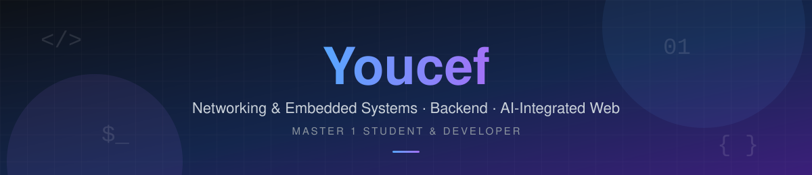

 

---

## About Me

I'm a **Networking & Embedded Systems (Master 1)** student and developer. I like building from the bottom up, from low-level code to full-stack applications, and understanding *how things really work* under the hood. I also design and build **AI-integrated websites**.

| Systems & Networking | Web & Backend | AI Integration | Cybersecurity |
|:---:|:---:|:---:|:---:|
| Linux, OS concepts, client–server architectures | REST APIs, Node.js, databases, secure auth | Websites powered by AI APIs and smart features | Currently learning and exploring |

> *Rigorous reasoning, clean design and technical correctness.*

---

## Tech Stack

### Languages

<table>
<tr>
<td align="center" width="110"> C</td>
<td align="center" width="110"> Java</td>
<td align="center" width="110"> JavaScript</td>
<td align="center" width="110"> TypeScript</td>
<td align="center" width="110"> PHP</td>
<td align="center" width="110"> SQL</td>
</tr>
</table>

### Systems & Tools

<table>
<tr>
<td align="center" width="110"> Linux</td>
<td align="center" width="110"> Arch Linux</td>
<td align="center" width="110"> Bash</td>
<td align="center" width="110"> Git</td>
<td align="center" width="110"><picture><source media="(prefers-color-scheme: dark)" srcset="https://cdn.simpleicons.org/github/white"></picture> GitHub</td>
<td align="center" width="110"> Docker</td>
</tr>
</table>

### Web & Backend

<table>
<tr>
<td align="center" width="110"> Node.js</td>
<td align="center" width="110"><picture><source media="(prefers-color-scheme: dark)" srcset="https://cdn.simpleicons.org/nextdotjs/white"></picture> Next.js</td>
<td align="center" width="110"> MongoDB</td>
<td align="center" width="110"> PostgreSQL</td>
</tr>
</table>

---

## AI-Integrated Websites

I build websites that bring AI into real products: AI-assisted content, smart listings and conversational features, all backed by a secure and well-structured backend.

---

## Final Year Project (PFE)

### Local Platform for Small Freelance Services

*Design and validation of a local digital platform for exchanging small freelance services.*

| | |
|---|---|
| **Marketplace** | Local platform for clients and providers |
| **Trust** | Reputation mechanisms |
| **Security** | OAuth-based authentication |
| **AI** | AI-assisted listings and communication |
| **Focus** | Usability and real-world constraints |

---

## What You'll Find Here

- Academic projects: networking, operating systems, software engineering
- Experiments and learning projects
- Architecture diagrams and documentation
- Final reports and deliverables

Every repository includes a clear **README**, setup and usage instructions, and explanations of design choices when relevant.

---

## GitHub Stats

---

**Feel free to explore my repositories and reach out to discuss tech, systems or project ideas.**

